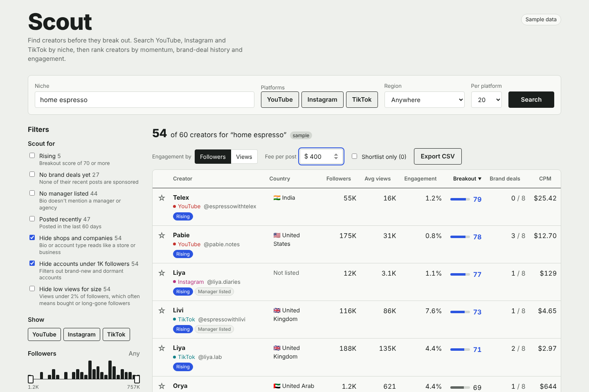
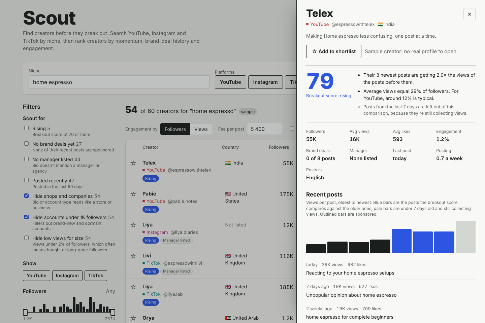
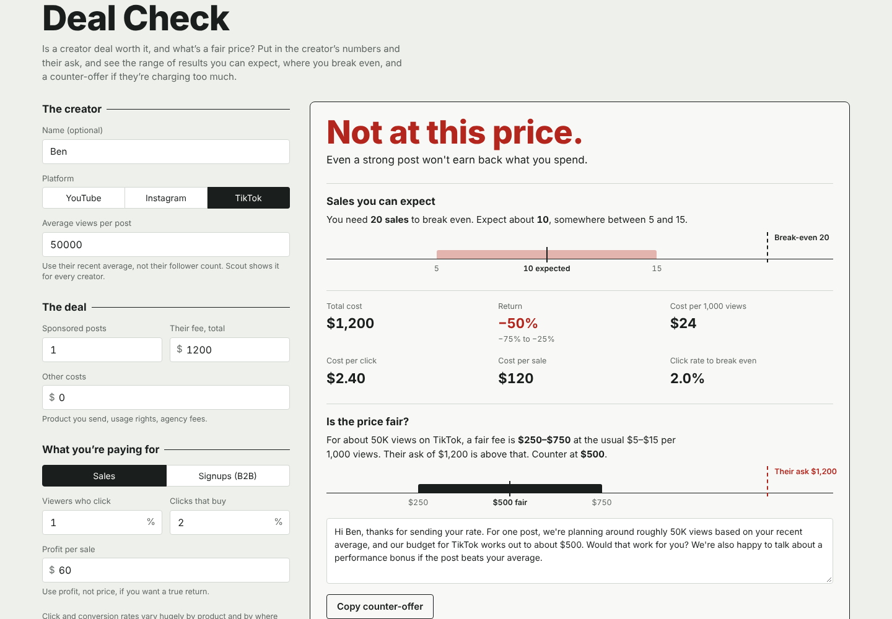

# Scout

**Find creators before they break out.** Search YouTube, Instagram and TikTok by niche, then rank creators by momentum, brand-deal history and engagement.

Live: https://scout-hazel-theta.vercel.app (sample mode for visitors)





Built by Mustafa Khan for scouting creators at Nexus Partners, and for any brand that wants to find creators without paying for a full influencer platform.

## Why it exists

Tools like Modash and HypeAuditor are built around huge creator databases, and they start at $199–$299 a month. They're good at finding creators who are already big. Scout is built for the opposite job: finding the ones who are about to be, and haven't been snapped up yet.

- **Breakout score (0–100).** Compares the median of a creator's 3 newest posts with the posts before, and checks average views against followers. 50 is typical; 70+ is flagged as rising. The score is always explained in plain words: "Their 3 newest posts are getting 2.2× the views of the posts before them."
- **Brand deals.** Counts recent posts marked as ads (TikTok `isAd`, YouTube paid-promotion flag, Instagram paid partnership) or with sponsor language in the caption. Filter to creators who've never done one, and be their first partner.
- **Manager listed.** Flags bios that mention a manager, agency or management email. Agencies can filter to unrepresented creators to sign; brands know who they'll be negotiating with.
- **Shop and company filter.** Hides stores and businesses that keyword searches tend to surface.
- **First message.** The detail panel writes a short outreach DM from what Scout measured (their best organic post and its views), so it never invents a compliment.
- **Pay per search.** A search costs cents on your own Apify account instead of a monthly subscription.

## Deal Check

A second tool at [`/deal`](https://scout-hazel-theta.vercel.app/deal): put in a creator's average views and their ask, and it shows

- the range of sales or signups you can expect, with the **break-even point drawn through it**
- return, CPM, cost per click and cost per sale
- a **fair fee range** from published CPM benchmarks (or your own target), and a counter-offer message when the ask is too high
- a B2B mode, where a signup's value comes from your close rate and customer value



Every creator in Scout has a **Check a deal** button that opens it prefilled. The math lives in `lib/deal.ts` and is covered by tests.

## What it does

- **Searches by niche** on one, two or all three platforms, with an optional region. Picking a region searches TikTok for the niche plus the country's name and its local hashtags, through a connection in that country, and points Instagram at local hashtags (for South Africa: #fashionsouthafrica, #southafricafashion). Before paying to read profiles, Scout drops shops and anyone placed in another country, and profiles creators clearly from the region first. Results then show only creators from there; ones with no country listed are one checkbox away.
- **Reads where a creator is from.** When a platform doesn't say, Scout reads the bio for flags, cities and "based in" lines (🇿🇦, Joburg, Cape Town, Mzansi) and marks the country "from bio".
- **Filters by gender.** Scout estimates gender from pronouns in the bio, then words like "mom" or "girl dad", then the first name. It never looks at photos. Business accounts and unclear names stay "can't tell", and you can correct any creator by hand.
- **Measures recent performance.** Scout reads each creator's latest posts (10 on YouTube, 8 on Instagram, 6 on TikTok) and averages their views, likes and comments, so you're comparing how accounts perform now, not just how big they are.
- **Gives two engagement rates.** Likes plus comments per post, divided either by followers (the usual Instagram measure) or by views (better for TikTok and YouTube, where reach doesn't depend on followers).
- **Puts a histogram on every filter.** Each slider shows how the current results are spread out, so you can see where the mid-tier creators cluster before you set a range.
- **Works out CPM.** Enter a fee per post and every creator gets a cost per 1,000 views.
- **Keeps a shortlist and exports CSV.** Star creators to keep them, then export to a sheet for outreach.

## How the data works

| Platform | Source | How creators are found | Country comes from |
|---|---|---|---|
| YouTube | Official YouTube Data API v3 | Videos about the niche from the past year, ranked by channel | The channel's own profile setting |
| TikTok | Apify `clockworks/tiktok-scraper` | Video search (through the chosen region's connection), then the top authors' latest videos | Where their videos were posted, else the bio |
| Instagram | Apify `apify/instagram-scraper` | Posts on the niche's hashtags (regional hashtags when a region is set), then the top accounts' profiles | The business address, else the bio |

Searching posts first, then profiles, matters: searching accounts directly mostly matches usernames, which surfaces shops and dead accounts instead of people actively making the content.

Instagram and TikTok don't offer a public creator search API, so Scout uses Apify scrapers for them. Those platforms' terms don't allow scraping, so keep live search for your own scouting at small scale. Don't open it up as a public service.

**Sample mode vs live mode.** Anyone who opens the site sees sample mode: invented creators, with the same filters and math. Live search needs a password, so visitors can't spend your API credits.

YouTube searches return in a few seconds. Instagram and TikTok start an Apify run in the background, and their results appear in the table as soon as the run finishes, usually within 1 to 3 minutes.

## Costs

Measured on real searches, 10 creators per platform:

| Platform | Cost per search | Time |
|---|---|---|
| YouTube | Free (about 130 of the 10,000 daily quota units) | 2–3 seconds |
| Instagram | about $0.08 | about 1 minute |
| TikTok | about $0.30 | about 1 minute |

TikTok costs about 3¢ per creator and Instagram under 1¢, so 50 TikTok creators is about $1.65. Scout shows the estimate under the Search button before you run it. Apify's free plan includes $5 of usage a month; start with 10–20 per platform. Each run's spend cap scales with the number of creators asked for, up to `APIFY_MAX_CHARGE_USD` ($2 by default), so a bad input can't run up a bill.

## Setup

1. **YouTube key.** Go to console.cloud.google.com, create a project, enable "YouTube Data API v3", then go to Credentials and create an API key. Restrict the key to that API.
2. **Apify token.** Create a free account at apify.com, then copy your token from Settings → API & Integrations.
3. **Run locally:**
   ```bash
   npm install
   cp .env.example .env.local   # fill in SCOUT_PASSWORD, YOUTUBE_API_KEY, APIFY_TOKEN
   npm run dev
   ```
4. **Deploy:** push to GitHub, import the repo at vercel.com/new, and add the same three variables under Settings → Environment Variables.

## Code tour

```
app/page.tsx                       search, filters, results table
app/components/RangeHistogram.tsx  dual-thumb slider drawn over a histogram
app/api/search/route.ts            runs YouTube searches, starts Apify runs, serves sample data
app/api/jobs/[platform]/[runId]    checks an Apify run and normalizes its results
lib/youtube.ts                     channel search + recent-upload stats
lib/apify.ts                       actor inputs and TikTok/Instagram normalizers
lib/metrics.ts                     averages, engagement rates, CPM
lib/filters.ts                     filtering, log-scale sliders, sorting, CSV export
lib/sample.ts                      deterministic invented creators for sample mode
lib/deal.ts                        Deal Check math: funnel, break-even, fair fee, counter-offer
app/deal/page.tsx                  Deal Check page
app/components/RangeBar.tsx        low–high band with a break-even or price marker
```

Tests cover the metrics, normalizers, filters, CSV escaping and access rules: `npm test`.

## Limits worth knowing

- YouTube's country is self-reported and often blank.
- Instagram hides like counts on some posts. Scout leaves those posts out of the average.
- Instagram photos have no view count, so their average views come from video posts only.
- Scrapers break when platforms change their pages. If a run fails, check the actor's page on Apify for updates.
